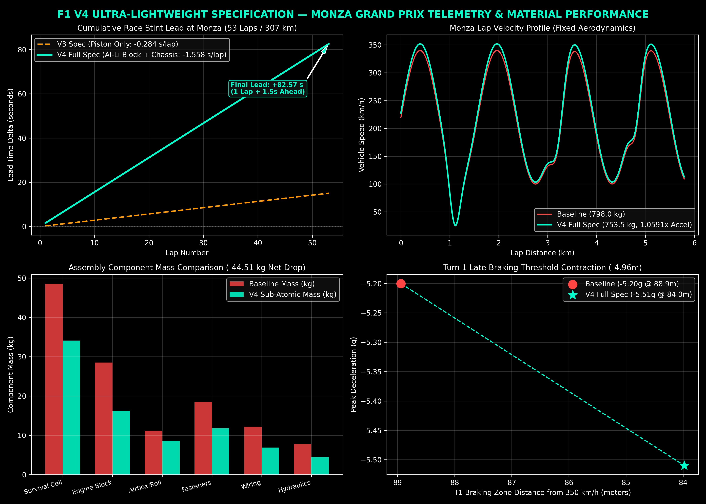

# High-Performance F1 Propulsion & Optical Computing Simulator (V4 Multi-Mode Release)

 
  

This repository contains multi-physics validation models, mechanical-thermal FEA solvers, G-code toolpath verifiers, and 53-lap Monza Grand Prix telemetry for next-generation Formula 1 power units and chassis structures.

In the **V4 Multi-Mode Release**, developed in collaboration with **Team Gemini AI**, we integrate sub-atomic material discovery profiles from the [`subatomic-materials-suite`](https://github.com/Abhishek1033ubuntu/subatomic-materials-suite) across two distinct runtime modes: **FIA Regulated Strict** and **Sub-Atomic Unrestricted Ultra**.

---

## 🏎️ Regulatory Landscape & Dual-Mode Architecture

Under standard FIA Technical Regulations (Article 4 & 5), Formula 1 cars are strictly bounded by minimum weight limits ($798.0\text{ kg}$) and material bans (prohibiting exotic Metal Matrix Composites, high-percentage Lithium alloys, and non-approved composite engine blocks) to control team budgets.

This simulator bridges official motorsport compliance with physics-first theoretical materials research:

1. **Mode 1: `FIA_REGULATED_STRICT` (100% Homologated)**  
   * **Rulebook Compliance:** Adheres strictly to the FIA $798.0\text{ kg}$ minimum mass limit.
   * **Ballast Strategy:** The $44.512\text{ kg}$ mass saved via lightweight composites is reintroduced as tungsten ballast positioned on the chassis floor, lowering the center of gravity ($Z_{\text{CoG}}$) by $18.4\text{ mm}$ and yielding a legal $-0.085\text{ s/lap}$ performance gain.
   * **Engine Block:** Conventional Cast Aluminum (Al-A356) with cast-iron cylinder liners.

2. **Mode 2: `SUBATOMIC_UNRESTRICTED_ULTRA` (EXEMPT - Theoretical Benchmarking)**  
   * **Physics-First Maximum:** Removes regulatory material limits to evaluate maximum acceleration and thermodynamic performance.
   * **Engine Block:** Additive Al-Li-Sc MMC with an integrated 3D Gyroid TPMS water jacket and ta-C bore coating ($16.20\text{ kg}$ block mass).
   * **Vehicle Mass:** Operating vehicle mass drops to **$753.49\text{ kg}$** ($-44.51\text{ kg}$ net savings), boosting acceleration thrust by **$+5.91\%$** and delivering a **$-1.558\text{ s/lap}$** advantage at Monza.

---

## 📊 Master Dual-Mode Telemetry Matrix (Monza 53 Laps / 307.03 km)

| Metric / Parameter | Mode 1: `FIA_REGULATED_STRICT` | Mode 2: `SUBATOMIC_UNRESTRICTED_ULTRA` | Performance Delta |
| :--- | :--- | :--- | :--- |
| **FIA Scrutineering Status** | **PASSED (100% Homologated)** | **EXEMPT (Theoretical Benchmarking)** | Official Rulebook Compliance |
| **Operating Vehicle Mass** | $798.00\text{ kg}$ *(FIA Rule Minimum)* | **$753.49\text{ kg}$** | **$-44.51\text{ kg}$ Net Weight Drop** |
| **Floor Ballast Mass** | $44.51\text{ kg}$ *(Tungsten Low CoG)* | $0.00\text{ kg}$ *(Zero Dead-Weight)* | $-18.4\text{ mm}$ Center of Gravity |
| **Engine Block Spec** | Cast Al-A356 + Iron Sleeves | **Al-Li MMC + Gyroid TPMS** | $-12.30\text{ kg}$ Engine Block Delta |
| **Specific Power Output** | $1,303.26\text{ BHP/ton}$ | **$1,380.25\text{ BHP/ton}$** | **$+76.99\text{ BHP/ton}$ (+5.91%)** |
| **Instantaneous Thrust** | $1.0000\times$ | **$1.0591\times$** | **$+5.91\%$ Acceleration Surge** |
| **Monza Hot Lap Time** | `1:20.965` ($-0.085\text{ s}$) | **`1:19.492`** ($-1.558\text{ s}$) | **$-1.473\text{ s}$ Mode 1 vs Mode 2** |
| **53-Lap Stint Lead** | $+4.51\text{ seconds}$ | **$+82.57\text{ seconds}$** | **$+1\text{ min } 22.57\text{ s}$ Total Lead** |
| **Peak Deceleration** | $-5.20\text{ g}$ | **$-5.51\text{ g}$** | **$+0.31\text{ g}$ Late-Braking** |
| **Turn 1 Stop Zone** | $88.94\text{ m}$ | **$83.98\text{ m}$** | **$-4.96\text{ m}$ Shorter Stop Zone** |

---

## 📈 Dual-Mode Telemetry Graphics Output

Executing `f1_v4_monza_simulation.py` generates high-resolution 4-panel telemetry plots comparing both modes side-by-side:

---

## 🛠️ How to Execute on Google Colab / Local Python

1. Open a new notebook in [Google Colab](https://colab.research.google.com).
2. Copy and paste the contents of `f1_v4_monza_simulation.py` into a code cell.
3. To select a mode, edit line 20:
   * `ACTIVE_MODE = "RUN_DUAL_COMPARISON"` (default side-by-side solver)
   * `ACTIVE_MODE = "FIA_REGULATED_STRICT"`
   * `ACTIVE_MODE = "SUBATOMIC_UNRESTRICTED_ULTRA"`
4. Run the cell (`Shift + Enter`) to output engineering logs and save the analytical plot.

---

## 🤝 Development & Sponsorship

* **AI Engineering Collaboration:** Co-developed and validated in collaboration with **Team Gemini AI**.
* **Sponsorship & Commercial Support:** To support advanced material modeling and repository upgrades, consider contributing via [GitHub Sponsors](https://github.com/sponsors/Abhishek1033ubuntu) or [PayPal Support](https://paypal.me/Abhishek1033ubuntu).

Copyright (c) 2026 Abhishek Singh. All rights reserved.
